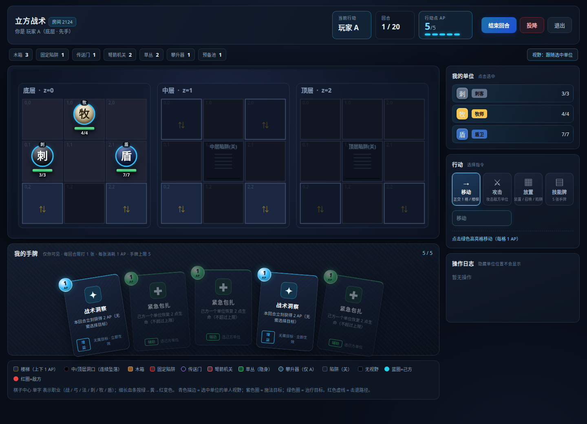
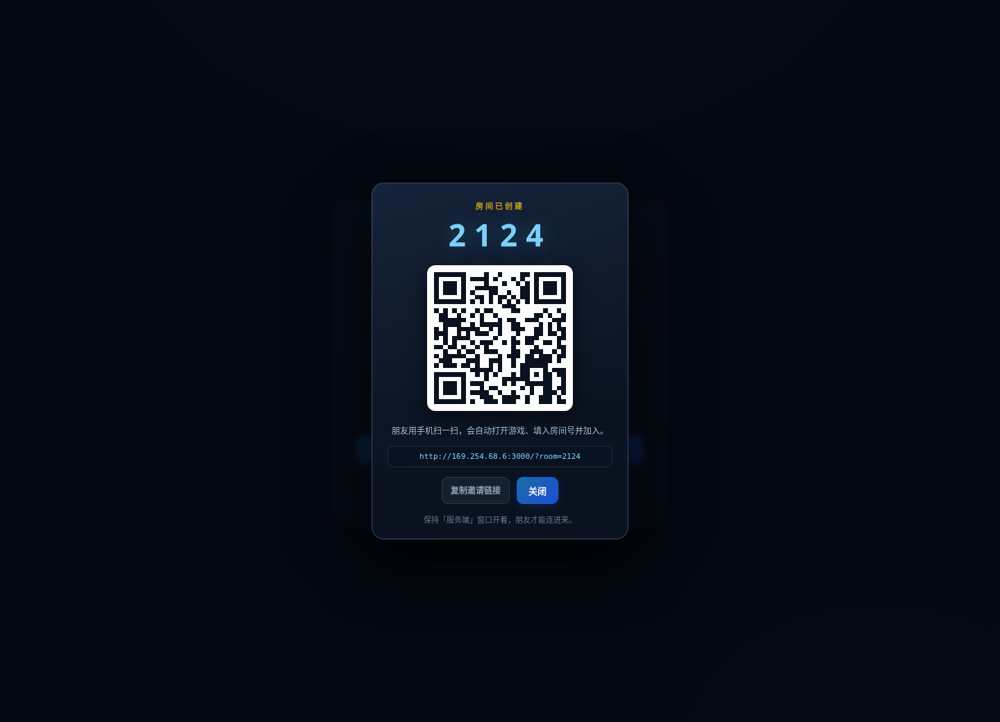

# 立方战术 · 3×3×3 双人回合制策略网页游戏（局域网 / 公网）

---

## 0++. 一键云部署（v6 · 本次更新 · 想发布到互联网先看这里）

这一章教你**不用买服务器、不用懂运维**，把游戏发布成一个真正的网页：朋友用手机或电脑浏览器打开网址就能玩，不需要连同一个 Wi-Fi。全程约 10 分钟。下文任何章节若与本章节冲突，一律以本章节为准。

### 0++.0 代码做了哪些改造（为什么能一键部署）

| 要求 | 实现位置与做法 |
| --- | --- |
| 统一端与端口 | `server/server.js` 一个进程同时干两件事：用 `express.static(dist)` 托管前端打包文件，用 Socket.io 提供联机；其余路径回退到 `index.html`（SPA）；`/health`、`/api/*`、`/socket.io` 由专用路由处理，不会被页面回退吞掉 |
| 环境变量 PORT | `const PORT = Number(process.env.PORT \|\| 3000)`，并 `listen(PORT, '0.0.0.0')`；云平台自动分配端口，无需手动设置 |
| 跨域支持 | `new Server(httpServer, { cors: { origin: '*' } })`，兼容平台预览域名、自定义域名、跨端调试 |
| 前端动态域名 | `src/net.ts` 用 `io(undefined)` —— socket.io-client 自动连「当前页面同源」地址，https 页面自动用 wss；二维码 / 邀请链接用 `location.origin`，云端自动得到 `https://xxx.zeabur.app`。**前端代码里没有任何写死的 localhost 或端口** |
| 构建与启动 | `npm install --include=dev && npm run build` 生成 `dist`；`npm start` 启动单端口服务 |
| 部署配置 | `render.yaml`（Render Blueprint）、`zbpack.json`（Zeabur 构建命令）、`package.json` 的 `engines.node` |

> **云端与本地的三点差异**：① 大厅显示「公网联机」，二维码指向公网域名；② 朋友不需要同一 Wi-Fi；③ 点右上角【退出游戏】只关闭你自己的页面，**不会关闭服务器**（否则会打断所有在线玩家，平台还会自动重启容器）。

### 0++.1 准备两个账号（各 1 分钟）

1. **GitHub**：打开 <https://github.com> → `Sign up` 注册（已有账号就跳过）。
2. **部署平台二选一**：
   - **Zeabur**（中文界面、国内访问较友好，推荐）：打开 <https://zeabur.com> → `Get Started` → 选 `Continue with GitHub`，用 GitHub 账号登录并授权。
   - **Render**：打开 <https://render.com> → `Get Started` / `Sign Up` → 同样用 GitHub 登录授权。

> Render 免费套餐在 15 分钟无人访问后会休眠，下次打开要等几十秒冷启动，属于正常现象；Zeabur 免费额度按用量计，具体以官网当前说明为准。

### 0++.2 第一步：把项目传到 GitHub（两种方式任选其一）

**方式 A：网页拖拽上传（完全不用命令行）**

1. 把 `游戏最终版.zip` **完整解压**到一个文件夹（不要在压缩包里直接操作）。
2. 打开 <https://github.com> → 右上角 `+` → `New repository`。
3. `Repository name` 填 `cube-tactics`，选 `Public`，**不要**勾选 "Add a README file"（保持空仓库），点 `Create repository`。
4. 在空仓库页面点 `uploading an existing file`（或 `Add file` → `Upload files`）。
5. 把解压后 `cube-tactics-lan` 文件夹**里面的全部文件和子文件夹**（`package.json`、`render.yaml`、`zbpack.json`、`server/`、`src/`、`shared/`、`README.md`、`一键启动.*` 等）一起拖进上传框。
   - ⚠️ 不要连外层 `cube-tactics-lan` 文件夹一起拖进去，要让 `package.json` 位于仓库**根目录**，否则平台找不到项目。
   - ⚠️ 不用上传 `node_modules/` 和 `dist/`，`.gitignore` 已排除；平台会自己装依赖、自己构建。
6. 拉到页面底部，点 `Commit changes`。完成，代码已经在 GitHub 上了。

**方式 B：命令行（会用终端就用这个）**

```bash
cd 解压后的 cube-tactics-lan 文件夹
git init
git add .
git commit -m "初始化立方战术"
git branch -M main
git remote add origin https://github.com/你的用户名/cube-tactics.git
git push -u origin main
```

把 `你的用户名` 换成你自己的 GitHub 用户名；若提示登录，按 GitHub 的提示用浏览器授权或 Personal Access Token。

### 0++.3 第二步 A：用 Zeabur 部署（推荐）

1. 登录 <https://dash.zeabur.com> → 点 `Create Project` → 选一个区域（如 `Hong Kong` / `Tokyo`）→ 自动进入项目页。
2. 点 `Deploy New Service`（或 `Add Service`）→ 选 `Git` / `Deploy from GitHub` → 首次使用点 `Configure` 授权 GitHub → 在仓库列表里搜索并选中 `cube-tactics` → 点 `Deploy`。
3. Zeabur 会**自动识别 Node.js**：执行 `npm install` → `npm run build`（`zbpack.json` 已写明构建命令）→ `npm start`。在 `Logs` 里看到 `🎮 游戏已启动！` 与 `云部署模式` 就成功了，约 1–3 分钟。
4. （建议做一次）点服务 → `Variables` → 添加 `CLOUD_DEPLOY` = `1` → 保存后自动重新部署。**不要设置 `PORT`**，平台自动分配并注入。
5. 点服务 → `Networking`（或 `Domains`）→ 点 **`Generate Domain`** → 填一个好记的前缀（如 `cube-tactics`）→ `Save`。
6. 生成的 `https://cube-tactics.zeabur.app` 就是你的**公网网址**。

### 0++.4 第二步 B：用 Render 部署（备选，同样简单）

1. 登录 <https://dashboard.render.com> → 右上角 `New` → 选 **`Blueprint`**（不是普通 Web Service）。
2. 连接 GitHub 账号 → 选择 `cube-tactics` 仓库 → Render 会读取仓库根目录的 `render.yaml` → 列出将要创建的服务 `cube-tactics` → 点 `Apply`。
   - `render.yaml` 已声明：`buildCommand: npm install --include=dev && npm run build`、`startCommand: npm start`、`healthCheckPath: /health`、环境变量 `CLOUD_DEPLOY=1` 与 `NODE_VERSION=20`。
3. 在 `Events` / `Logs` 里等部署完成（约 2–5 分钟），状态变成 `Live` 即成功。
4. 服务页面顶部的 **`https://cube-tactics.onrender.com`** 就是公网网址（Render 自动分配，不用手动生成域名）。

> 如果你用的是普通 `New → Web Service`：`Runtime` 选 `Node`，`Build Command` 填 `npm install --include=dev && npm run build`，`Start Command` 填 `npm start`，`Health Check Path` 填 `/health`，再到 `Environment` 加 `CLOUD_DEPLOY=1`。用 Blueprint 更省事。

### 0++.5 第三步：拿到网址，开始玩

1. 复制上一步的公网网址（`https://xxx.zeabur.app` 或 `https://xxx.onrender.com`）。
2. 自己用浏览器打开：看到「立方战术」大厅、连接状态为「已连接联机服务器」即部署成功。
3. 把网址发给朋友（微信 / QQ 都行），或让朋友扫大厅里的二维码；**不需要同一个 Wi-Fi**。
4. 玩家 A 点「创建房间」→ 把弹出的带房间号二维码或邀请链接发给 B；B 打开链接会自动填入房间号，点「加入」即可开战。
5. 以后改了代码，只要 `git push`，两个平台都会自动重新部署。

### 0++.6 环境变量说明

| 变量 | 要不要手动设 | 说明 |
| --- | --- | --- |
| `PORT` | **不要** | 平台自动分配并注入；服务端用 `process.env.PORT \|\| 3000` 读取，绑定 `0.0.0.0` |
| `CLOUD_DEPLOY` | 建议设 `1` | Render 的 `render.yaml` 已自动设置；Zeabur 在 `Variables` 里手动加一次。开启后退出按钮不结束服务器、大厅显示「公网联机」 |
| `NODE_VERSION` | 不用 | `package.json` 的 `engines.node`（>=18）与 `render.yaml`（20）已声明 |
| `VITE_SERVER_URL` | **不要** | 仅留给本地开发连另一台机器；云部署留空，前端自动连当前页面域名 |

> 即使忘记设置 `CLOUD_DEPLOY`，服务端也会按请求 Host 自动识别公网访问（平台域名不是 localhost），不会误杀进程。

### 0++.7 出问题了？照着这张表排查

| 现象 | 原因 / 解决 |
| --- | --- |
| 打开是白屏、404 或「前端尚未构建」提示页 | 前端没构建：在平台 `Settings` 把 Build Command 设为 `npm install --include=dev && npm run build` 后重新部署。可先访问 `https://你的域名/health` 确认服务是否活着 |
| 大厅一直「正在连接服务器…」 | 看平台 `Logs` 里服务是否 Running；免费套餐休眠后首次访问等 30–60 秒；确认 Start Command 是 `npm start` |
| 部署日志报 `vite: not found` / `tsc: not found` | 平台把 devDependencies 省略了：Build Command 里务必带 `--include=dev` |
| 二维码指向 `169.254.*` 或内网 IP | 前端已改为取当前页面域名，刷新页面 / 清缓存即可 |
| 点【退出游戏】后服务重启 | 正常情况不会发生（按 Host 自动判定公网）；若发生请补上 `CLOUD_DEPLOY=1` |
| Render 一直 `Deploy failed` | 看 `Events` 日志；确认 Health Check Path 为 `/health`、服务绑定 `0.0.0.0`、端口读的是 `$PORT` |

### 0++.8 本地运行方式完全没变

双击 `一键启动.bat`（Windows）/ `一键启动.command`（Mac），或在项目目录执行 `npm install && npm run build && npm start`，访问 `http://localhost:3000`；同一 Wi-Fi 的手机扫大厅二维码即可联机。云端与本地共用同一套代码，部署不需要改动任何一行。

### 0++.9 v6 验证结果

- **单测 47/47 通过**：新增 3 项云部署测试（PORT + 单端口托管 + CORS、云端退出不杀进程、公网 Host 自动识别为云端），原有 44 项规则 / 联机 / 大厅退出测试全部保持通过。
- **构建通过**：`tsc --noEmit` + `vite build`。
- **云环境模拟真机验收 14/14 通过，0 运行时错误**（`CLOUD_DEPLOY=1` + 平台动态端口 3211 + `X-Forwarded-*` 反代头）：
  - `PORT=3211` 生效，`/health` 返回 `mode: cloud`、`cloud: true`、`dist: true`；
  - 同一进程提供 `/`、JS、CSS 与 SPA 回退（`/room/1234` 返回 `index.html`），`/api/does-not-exist` 仍是 404 JSON，不被页面回退吞掉；
  - `OPTIONS /socket.io` 预检返回 `204` 且 `Access-Control-Allow-Origin: *`，外部 Origin 的 Socket.io 客户端也能连上；
  - 浏览器里的 Socket.io 请求全部指向页面同源 `http://127.0.0.1:3211/socket.io/...`，**没有任何 `localhost:3000` 硬编码**；
  - 大厅显示「公网联机 / 公网可访问」，地址等于 `location.origin`；创建房间后的邀请链接为 `http://127.0.0.1:3211/?room=7831`（动态域名）；
  - `X-Forwarded-Host: cube-tactics.zeabur.app` 被还原为 `https://cube-tactics.zeabur.app`；
  - 云端点【退出游戏】→【确认】：显示「云端游戏不会关闭服务器」，`window.close()` 被调用，而 `/health` 仍 200、进程 `exitCode` 仍为 `null`（不会打断其他玩家）。
- **v5 回归 16/16 通过**：桌面大厅按钮、弹窗文案、取消留在大厅、本地确认关闭进程、移动端 / 对局 / 观战界面隐藏按钮，全部未受影响。
- **打包校验**：`unzip -t` 无错误；解压后分别以局域网模式和云模式启动，`/health`、首页、JS/CSS 均 200，云模式 `/api/shutdown` 不杀进程。
- 截图：`shots/25-cloud-lobby.png`、`shots/26-cloud-invite.png`、`shots/27-cloud-exit-page.png`。

---

## 0+. 最终版 v5（上一轮更新）

本次交付包仍为 **`游戏最终版.zip`**。v5 只做一件事：**给电脑版大厅补上退出功能**。大厅原有的匹配、创建房间、加入房间、扫码邀请、观战、局域网二维码等逻辑**一行未改**，v2 / v3 / v4 的全部机制（战争迷雾、预备池召唤、分类出牌限额、横竖屏自由切换等）也全部保持不变。除最前面的 v6 云部署章节外，下文各章节若与本章节冲突，一律以本章节为准。

### 0+.A 交互行为

| 步骤 | 行为 |
| --- | --- |
| 电脑端打开大厅 | 界面**右上角**常驻【退出游戏】按钮（Portal 挂到 `body`，`z-index: 2147483647`，不被二维码弹窗等内容遮挡，可正常点击） |
| 点击按钮 | 弹出确认弹窗，文字为 **「确定退出，返回桌面吗？」**，提供【确认】与【取消】 |
| 点击【取消】 | 关闭弹窗，**留在大厅**，不改动任何状态；按 Esc 或点遮罩空白处等效于取消 |
| 点击【确认】 | **关闭游戏进程**（`node server/server.js` 优雅退出），页面切到「游戏已退出」全屏页并尝试关闭浏览器窗口，回到桌面 |

- 确认前会先向所有联机客户端（含手机、观战者）广播 `serverShutdown`，让对方显示退出页而不是陷入「连接已断开，正在重连…」的循环。
- Windows 的「一键启动」在服务端**正常退出**时会自动关闭那个最小化的服务端窗口，桌面上不留残留窗口；Mac 的启动脚本会打印退出提示。

### 0+.B 「关闭游戏进程」的实现与边界

本项目是「浏览器前端 + Node 服务端」结构，真正的游戏进程就是一键启动脚本拉起的 `node server/server.js`。网页 JS 受浏览器沙箱限制无法直接结束系统进程，因此链路设计为：

1. 前端 `POST /api/shutdown`（`src/net.ts` 的 `requestShutdown()`）。
2. 服务端 `server/server.js` **先回响应**，再 `io.emit('serverShutdown')` 广播，随后关闭 Socket.io / HTTP 并 `process.exit(0)`。幂等标志 `shuttingDown` 保证重复点击只执行一次；另有 `quitGame` Socket 通道作兜底。
3. 前端收到响应后展示退出页，并调用 `window.close()` 尝试关闭游戏窗口。

> **浏览器限制说明**：Chrome / Edge / Safari 只允许脚本关闭「由脚本自己打开的窗口」。若浏览器拦截了自动关窗，页面会保留「游戏已退出」全屏页，上面有【关闭此窗口】按钮，直接关掉标签页即可回到桌面；**游戏服务端进程此时已经确实结束**（`/health` 不再响应）。这是 Web 版本在不引入 Electron 等桌面封装的前提下能做到的完整行为。

### 0+.C 仅「电脑端大厅」可见

- **界面位置**：`src/App.tsx` 只在 `!room && !spectating` 的**大厅分支**渲染 `ExitGameButton`；等待房间、选人、对局、观战界面都不渲染该组件，因此按钮不会出现。
- **设备判定**：`src/components/ExitGame.tsx` 的 `isDesktopClient()` 用「移动端 UA + iPadOS 伪装 Mac 的多点触控 + 无 hover 的纯触屏」三重判断，手机 / 平板扫码打开的大厅不渲染按钮；`styles.css` 另有 `max-width: 760px` 的窄屏隐藏作为双保险。
- **安全校验**：`server/shutdown.js` 的 `isLocalRequest()` 只允许来自本机（回环地址或本机任一网卡 IP）的退出请求；手机等局域网远端即使手工构造请求也会得到 `403`，不会误关房主的游戏。
- `src/components/Lobby.tsx` 未作任何修改，大厅所有原有功能与视觉布局保持原样。

### 0+.D v5 验证结果

- **单测 44/44 通过**：新增 3 项（`normalizeIp` 归一化、`isLocalRequest` 本机允许 / 远端拒绝、`POST /api/shutdown` → `serverShutdown` 广播 → `process.exit(0)` 端到端），原有 41 项规则与联机测试全部保持通过。
- **构建通过**：`tsc --noEmit` + `vite build`。
- **Chromium 真机验收 16/16 通过，0 运行时错误**：
  - 桌面大厅：右上角按钮存在，`document.elementFromPoint()` 命中的就是按钮本身（层级正常、可正常点击）；创建房间、加入房间、观战 A/B、复制链接、局域网二维码、联机状态全部在。
  - 点击按钮：弹窗文案精确为「确定退出，返回桌面吗？」，按钮为【确认】【取消】，`role="dialog"`、遮罩 `z-index: 2147483647`。
  - 点【取消】：弹窗关闭，标题仍为「立方战术」，创建房间按钮仍在，连接仍为 `conn-pill ok`。
  - 点【确认】：页面切到「游戏已退出」，`window.close()` 被调用；服务端 `exitCode = 0`、`/health` 不可达、监听客户端收到 1 次 `serverShutdown`（reason「房主已关闭游戏」）；大厅 / 弹窗 / 按钮 / 断线横幅全部消失。
  - 移动端（390×844，iPhone UA）：`.exit-game-fixed` 数量为 0，大厅功能完整。
  - 等待房间 / 选人 / 对局 / 观战四个界面：按钮数量均为 0；棋盘、结束回合、5 张手牌正常。
- **打包校验**：`unzip -t` 完整，解压后启动 `/health`、首页与 JS/CSS 均返回 200。
- 验收截图：`shots/21-pc-lobby-exit.png`、`shots/22-exit-confirm.png`、`shots/23-game-exited.png`、`shots/24-mobile-no-exit.png`。

---

## 0. 最终版 v4（上一轮更新）

本次交付包仍为 **`游戏最终版.zip`**。v4 仅调整**出牌限额规则**，**卡牌基础放置、AP 扣费、装置落地、弃牌堆、目标归属与可见性校验全部保持不变**；除最前面的 v5 章节外，下文各章节若与本章节冲突，一律以本章节为准。

### 0.A 分类出牌限额（替代原「每回合手牌仅可打出一张」全局限制）

| 卡牌类型 | 包含卡牌 | 单回合限额 | 行为 |
| --- | --- | --- | --- |
| **装置牌**（场上放置类） | 木箱、草丛、固定陷阱、传送门、弩箭机关、攀升器 | **无上限** | 只要剩余 AP 满足每张消耗，同一回合内可**连续打出多张**，逐张正常完成放置 |
| **技能牌**（战术 / 非放置类） | 强力击退、紧急包扎、战术洞察、致盲烟雾 | **每回合最多 1 张** | 成功打出后置 `perTurnFlags.skillCardUsed`，仅阻止本回合后续技能牌 |

- **两类互不干扰**：技能牌用掉后装置牌仍可继续打出；先打装置牌也不占用技能牌名额。
- **AP 独立校验**：每张牌打出时都单独判断 `AP >= 1`；装置牌连打同样逐张扣费、逐张校验，AP 不足即拒绝。
- **新回合刷新**：`beginPlayerTurn()` 在开局与每次 `endTurn` 换手时清空 `skillCardUsed`，玩家在新回合重新获得一次技能牌机会。
- **服务端权威**：分类在 `shared/constants.js` 定义（`SKILL_CARDS`、`isDeviceCardType()`、`isSkillCardType()`），`canPlayCard()` 与 `buildHints()` 均按类型判定；前端只做即时提示，不做规则计算。
- **前端提示**：手牌区标题改为「技能牌每回合 1 张 / 装置牌不限量」；技能牌用掉后显示「本回合技能牌已用」标签；点击被限额的技能牌会提示「本回合已打出过技能牌（技能牌每回合限 1 张，装置牌仍可继续打出）」。

### 0.B v4 验证结果

- 单测 **41/41** 通过（新增第 41 项：装置牌同回合连打 3 张 / 技能牌 1 张限制 / 新回合刷新 / AP 独立校验 / `viewFor` 新字段）。
- 构建通过（`tsc --noEmit` + `vite build`）。
- 真机验收 **15/15** 通过、**0 运行时错误**：
  - 浏览器 UI：打出技能牌 → 标签出现 → 第二张技能牌被提示拒绝 → 装置牌仍可进入选格并完成放置 → 换回合标签消失 → 新回合可再次打出技能牌。
  - 规则层：同回合连续 3 张装置牌全部成功、每张 −1 AP、3 张装置落地、3 张进弃牌堆、`skillCardUsed` 始终为 `false`。

---

## 0-1. 最终版 v3（上一轮修复）

本次交付包仍为 **`游戏最终版.zip`**。v3 在 v2 的全部功能基础上修复了 5 类问题，**卡牌打出 / 放置落地的逻辑与数值完全未动**；下文 v2 及更早章节与本章节冲突时，一律以本章节为准。

### 0.A 横竖屏自由切换 & 结束回合按钮

| 项目 | v3 行为 |
| --- | --- |
| 方向锁定 | **已彻底移除**：不再调用 `screen.orientation.lock()`、不再弹出竖屏遮罩、不再往 `body` 加 `portrait-blocked` 隐藏棋盘。竖屏 / 横屏自由双向旋转，旋转后由响应式栅格自动重排，不出现溢出、消失、错位 |
| 【结束回合】按钮 | 通过 React Portal 渲染到 `body` 层，`position: fixed` 固定**屏幕右上角**，`z-index: 2147483647`（全局最高）。横屏、竖屏、展开图例、悬停卡牌、滚动日志、弹出提示时都保持可见、可点击，不被任何元素遮挡 |
| 底部重叠 | 大段图例改为 `<details>` **默认折叠成一行**（点击展开），手牌区整体上移；5 张卡牌横向等分排布、**互不重叠**，卡名 / AP 消耗 / 效果文字全部清晰可见 |
| 横屏分区 | 上方棋盘战斗区、下方手牌区、右侧操作日志区三块分离排布（grid `board / hand / side`），互不挤压；窄屏与竖屏自动改为纵向三段，日志限高内部滚动 |
| 全屏按钮 | 大厅按钮改为「全屏游玩」——只进出全屏，不锁任何方向 |

### 0.B 开局单位生成（修复）

| 项目 | v3 行为 |
| --- | --- |
| 开局生成 | 盲选 3 个出战单位，开局**只生成 1 个首发**（阵容第 0 个职业）：A 固定 `(0,1,0)`、B 固定 `(2,1,2)` |
| 其余 2 个 | 进入**预备召唤池**，开局不生成在战场上（`reservePool` 下发给前端渲染） |

### 0.C 召唤规则（修复随意 / 重复召唤漏洞）

| 项目 | v3 行为 |
| --- | --- |
| 名单限制 | 只能召唤**本局预选的这 3 个单位**（除首发外的 2 个名额）；服务端只认 `reservePool` 里的名额 key，客户端传任何名单外职业（如 `cls: 'guardian'`）一律拒绝 |
| 一次性 | 每个名额整局**只允许召唤一次**；召唤后立即标记【已召唤】并在预备池**锁死**（前端禁用 + 服务端拒绝），不能再次召唤 |
| 入口 | **仅限预备池条目点击**：手牌区左侧「预备召唤池」中点击未召唤的名额 → 棋盘亮黄格 → 点击落地（2 AP，召唤后当回合可行动）。原「召唤队友」按钮与职业下拉框已删除 |
| 上限 | 场上最多 3 个单位（1 首发 + 2 名额） |

### 0.D 回合 AP 重置（修复开局 AP=0）

| 项目 | v3 行为 |
| --- | --- |
| 统一入口 | 新增 `beginPlayerTurn()`：开局（A 先手）与每次 `endTurn` 换手都走它，**立刻把 AP 重置为 5** 并清空每回合标志 |
| 双保险 | `viewFor` 增加防御：回合刚开始（尚无任何动作）却异常出现 `ap=0` 时仍按 5 下发；玩家正常把 5 AP 花光变成 0 不受影响 |

### 0.E 楼梯坐标（修复错误跨层连通）

| 项目 | v3 行为 |
| --- | --- |
| 楼梯点位 | 底层 z=0：`(0,2,0)`、`(2,2,0)`；顶层 z=2：`(0,2,2)`、`(2,2,2)`；中层 z=1 仅保留同坐标垂直中转点 `(0,2,1)`、`(2,2,1)`。原先多出的 `(0,0,1)`、`(2,0,1)` 已移除 |
| 连通白名单 | 新增 `STAIR_LINKS` 显式配对表（4 条边）+ `isStairLink()`：移动、攻击跨层、跨层视野扩展**只允许同 (x,y) 的配对边**，任何斜角、跨 2 层、非配对点组合一律拒绝 |

### 0.F v3 验证结果

- `npm test`：**40 项全部通过**（新增 v3 修复总验收用例，卡牌相关断言原样保留且通过）
- `npm run build`：`tsc --noEmit` + `vite build` 通过
- 真机 Chromium 验收 **16/16 通过**：横屏(1440×900)/竖屏(390×844)双向切换重排、结束回合按钮 fixed + 最高层级 + `elementFromPoint` 命中、三区 rect 零重叠、5 张手牌零重叠且文字完整、图例默认折叠、开局 AP=5 / 1 首发 / 预备池 2、预备池召唤后名额锁死、致盲烟雾卡选格落地正常、运行时错误 0

---

## 0-2. 最终版 v2（上一轮交付）

本次交付包为 **`游戏最终版.zip`**，内含完整项目目录 `cube-tactics-lan/`（`src/`、`server/`、`shared/`、`tests/`、`tools/`、`dist/`、`shots/`、一键启动脚本等），解压后即可运行。本章节描述的是**最新规则与 UI**；下文各章节若与本章节冲突，一律以本章节为准。

### 0.1 战争迷雾可视化与【致盲烟雾】

| 项目 | 最终版行为 |
| --- | --- |
| 迷雾遮罩 | 视野外的**所有格子**覆盖 `rgba(0,0,0,0.75)` 深色半透明遮罩，地形变暗 |
| 迷雾内敌方单位/装置 | 服务端 `viewFor()` **根本不下发坐标**，前端既不渲染也不响应点击（绝对不可见、不可点击、防作弊） |
| 视野依据 | 服务端按「己方所有存活单位视野并集」权威计算，前端不再提供「跟随选中 / 合并并集」切换（视觉减负） |
| 观战者 | 大厅输入房间号可选「观战玩家 A / B」，或访问 `?spectate=房间号&side=A`；服务端按该阵营生成**带迷雾的专属 PlayerView** 并持续广播，标记为只读 |
| 新卡【致盲烟雾】 | 1 费通用战术卡；打出后选**全图任意一个可见格**，以该格为中心的同层 **3×3** 区域被黑雾笼罩，持续 **2 个回合** |
| 黑雾效果 | 处在黑雾内的**敌方单位**视野降为「自身周围 1 格」（同层 3×3，不再做楼梯扩展）；黑雾对受制方还会遮蔽区域内没有己方单位贴身的格子 |
| 黑雾特效 | 前端 Canvas 用多层缓慢漂移的黑色径向渐变绘制翻滚烟雾，紫色虚线描边并标注剩余回合数 |

### 0.2 首发出生与全层召唤

| 项目 | 最终版行为 |
| --- | --- |
| 首发固定坐标 | 玩家 A（底层 z=0）**`(0,1,0)`**、玩家 B（顶层 z=2）**`(2,1,2)`**（阵容第 1 个单位） |
| 召唤消耗 | **2 AP**，从预备池召唤队友，预备池整局 1 个名额、每回合最多 1 次 |
| 召唤位置 | A 可在**底层 z=0 任意合法空格**、B 可在**顶层 z=2 任意合法空格**召唤（不再是单一固定召唤点） |
| 前端提示 | 点击手牌区的「召唤队友（2 AP）」后，己方初始层的合法空格**亮起黄色高亮**；点击完成召唤 |
| 召唤后 | 新单位 `hasAttacked = false`，**当回合即可移动 / 攻击** |

### 0.3 装置卡牌化、核心操作与手牌动画（UI 重构）

| 项目 | 最终版行为 |
| --- | --- |
| 右侧面板 | **彻底删除【移动】【攻击】【放置】按钮**，只保留【结束回合】大按钮与操作日志；投降 / 退出移到顶部 HUD |
| 装置变卡牌 | 【木箱】【草丛】【固定陷阱】【传送门】【弩箭机关】【攀升器】全部做成卡牌并加入**公共牌库**；**攀升器是特例，只加入玩家 A 的初始牌库**，B 永远抽不到也打不出 |
| 装置出牌流程 | 点击手牌 → 扣 **1 AP** → 棋盘**亮起黄色合法格** → 点击完成放置 → **卡牌飞入弃牌堆**（弃牌堆计数 +1） |
| 点击单位 | **无悬浮菜单**：点击己方单位立刻**同时**显示移动范围（绿格）与攻击范围（红圈）；点绿格直接移动、点红圈敌人直接攻击、点空白/非法格取消选中 |
| 陷阱开关 | 无需按钮，直接点击暗金高亮的中/顶层中心陷阱格（1 AP，中/顶层共用每回合 1 次） |
| 手牌排列 | 底部横向**重叠扇形**，悬停上浮发光；牌库 / 弃牌堆图标分居左右 |
| 手牌动画 | 抽牌：新卡从牌库方向飞入；打牌：卡飞向棋盘中央淡出；装置/烟雾卡：卡飞向弃牌堆 |
| 主动抽牌 | 每回合开始**自动抽 2 张**；点击【牌库】图标可花 **1 AP** 主动抽 1 张；**手牌上限严格 5 张**，满手不再抽；牌库抽空自动把弃牌堆洗回 |
| 起手配方 | 开局 5 张 = 战术洞察 / 紧急包扎 / 强力击退 / 致盲烟雾 + 1 张装置卡（A 为攀升器，B 为随机公共牌） |

> 公共牌库共 **10 种卡**：3 张通用战术牌 + 致盲烟雾 + 6 张装置卡。所有卡牌规则与合法性均由服务端 `shared/rules.js` 权威校验，`hints.cardCells` 负责下发黄色合法格。

### 0.4 表情包与视觉清理

- 废弃实心文字方块，改为**屏幕侧边**弹出的**半透明磨砂气泡**（`backdrop-filter` 模糊）包裹**大号 Emoji**；弹性缩放弹入 → 停留约 2 秒 → **向上淡出**；`pointer-events: none`，贴屏幕左右边缘且不遮挡棋盘。
- **视觉减负**：未选中网格进一步调暗、棋子取消常驻阵营发光，仅在选中 / 可攻击 / 交互高亮时才发光。

### 0.5 验证与运行

- `npm test`：**39 项全部通过**（38 条规则单测 + 1 条双客户端联机端到端测试，含新增的迷雾/烟雾/装置卡/抽牌/观战断言）。
- `npm run build`：`tsc --noEmit` + `vite build` 均通过，`dist/` 为最新构建产物。
- 启动方式不变：双击 `一键启动.bat` / `一键启动.command`，或 `npm run build && node server/server.js`。

### 0.6 操作速查

| 想做的事 | 操作 |
| --- | --- |
| 移动 / 攻击 | 点击己方单位（绿格 + 红圈同时出现）→ 点绿格移动 / 点红圈敌人攻击 |
| 放装置 / 放烟雾 | 点手牌 → 点黄色高亮格 |
| 对单位施法 | 点手牌 → 点紫色高亮单位 |
| 立即生效卡（战术洞察） | 直接点手牌 |
| 召唤队友 | 选职业 → 点「召唤队友」→ 点黄色高亮格（2 AP） |
| 主动抽牌 | 点【牌库】图标（1 AP，手牌须 < 5） |
| 开关中/顶层陷阱 | 点暗金高亮的中心陷阱格 |
| 取消当前选择 | 点棋盘空白处，或手牌区「取消」/ 再点一次该卡 |
| 观战 | 大厅输入房间号 → 「观战玩家 A / B」；或 `?spectate=XXXX&side=A` |

---

一个可直接在浏览器运行的双人回合制策略游戏。最终形态为**前后端分离的局域网联机对战**：Node.js + Express + Socket.io 负责权威规则校验与服务端战争迷雾，React + Canvas 2D 只负责渲染与发送操作意图。

> 需求经历了十次迭代：① 本地同屏 MVP → ② 数值/迷雾/特效升级（AP 5、召唤点、十字视野、刀光箭矢火球）→ ③ 重构为局域网联机 → ④ 机制补全（弩箭机关、草丛隐身、技能牌）→ ⑤ 6 职业池 + 开局盲选（BP）阶段 + 暗黑地牢风 UI 重构 → ⑥ 立体地形深化（顶层陷阱、连续坠落、攀升器、防重叠卡层）+ 楼梯重排 + 全面视觉重构 → ⑦ 极简启动与智能联机（一键脚本、终端局域网 IP、大厅/房间二维码扫码加入）→ ⑧ **纯战棋平A流平衡**：彻底剥离所有主动技能 / 专属卡，六职业只保留基础攻击 + 天生被动，法师终极削弱、盾卫坚韧改为「所有伤害 -1 保底 1」，开局发 5 张通用牌 → ⑨ **局内互动与战斗打击感**：6 宫格表情包（服务端广播 / 3 秒 CD / 观战者可见）、60ms 顿帧、屏幕震动与白闪、受击纯白闪烁、Web Audio 合成音效与一键静音。→ ⑩ **移动端横屏适配**：全屏 + 方向锁定引导、竖屏旋转遮罩、70% 棋盘 + 右侧纵向栏 + 横向可滑手牌、44px 触控热区与 :active 按压反馈。→ ⑪ **最终版 v2**：战争迷雾遮罩可视化 +【致盲烟雾】卡牌、固定首发出生 + 全层 2 AP 召唤、装置全部卡牌化 + 删除右侧动作按钮 + 扇形手牌/牌库/弃牌堆/主动抽牌、磨砂表情气泡与视觉减负、观战者继承被观战玩家的迷雾视野。→ ⑫ **最终版 v3**：横竖屏自由切换与结束回合按钮常驻、开局只生成 1 首发 + 预备池一次性召唤、换手 AP 立刻重置为 5、楼梯严格坐标配对。→ ⑬ **最终版 v4**：删除「每回合仅可打出一张」全局限制，改为**装置牌无单回合上限、技能牌每回合 1 张**（新回合刷新、两类互不干扰、AP 每张独立校验）。本仓库是**十三步合并后的最终交付形态**；第 ⑬ 步只调整出牌限额，**任何细节冲突一律以第 0 章为准**。
>
> 

---

## 1. 运行方式

### 最简单：双击一键启动（零命令行基础）

| 系统      | 双击这个文件         | 说明                                                      |
| ------- | -------------- | ------------------------------------------------------- |
| Windows | `一键启动.bat`     | 自动检测 Node → 装依赖 → 构建 → 开服务 → 打开浏览器                      |
| macOS   | `一键启动.command` | 同上。首次双击若提示没有权限：右键 →「打开」，或先在终端执行 `chmod +x 一键启动.command` |

> ⚠️ **必须把压缩包「完整解压」后再双击**：最终交付包为 `游戏最终版.zip`，解压后的整个项目文件夹要一起保留（能看到 `package.json`、`server`、`src`、`dist`），不能只把 `一键启动.bat` 单独拖到桌面。若只在桌面留了这一个文件，脚本会自动到桌面/下载/文档里寻找项目文件夹；实在找不到时会明确提示，不会再把 npm 报错刷满屏。
>
> Windows 脚本的**第一行就是 `cd /d "%~dp0"`**：双击后先切到脚本所在目录，再依次执行 `npm install` → `npm run build` → `node server/server.js`；所有报错分支都带 `pause`，窗口不会一闪而过。

脚本会依次完成：

1. 检测 Node.js（没装就直接打开 <https://nodejs.org/> 并给出提示）；
2. `node_modules` 不存在时执行 `npm install`；
3. `npm run build` 构建前端；
4. 启动 `node server/server.js`，然后轮询 `/health` 直到服务就绪；
5. 自动用系统默认浏览器打开 `http://localhost:3000`。

终端里会打印醒目的启动信息（服务端用 `os.networkInterfaces()` 探测真实局域网 IPv4，自动排除回环、Docker/VMware 虚拟网卡与 169.254 链路本地地址）：

```text
🎮 游戏已启动！
   本机访问：http://localhost:3000
   局域网联机（请把这个地址发给朋友）：http://192.168.1.7:3000
```


> Windows 下服务端跑在独立的最小化窗口里，**关掉那个窗口即停止游戏**；Mac 下服务端就在当前终端，关闭窗口或 `Ctrl + C` 即停。若服务已经在运行，脚本不会重复启动，只负责打开浏览器。

#### 如果双击后提示「没有找到项目文件」

说明双击的这个 `一键启动.bat` 不在项目文件夹里（常见的情况：解压后只把这个 bat 拖到了桌面）。任选一种解决：

1. 把 `一键启动.bat` **放回解压出来的 `cube-tactics-lan` 文件夹**（与 `package.json` 同级）再双击；
2. 或者把整个 `cube-tactics-lan` 文件夹**直接拖到 `一键启动.bat` 图标上**松开；
3. 或者按 `Win + R` 输入 `cmd`，执行：

```bat
cd /d "%USERPROFILE%\Desktop\cube-tactics-lan"
npm install
npm run build
node server/server.js
```

脚本自身也会自动到桌面、下载、文档里找项目文件夹（最多两层），找不到时给出上面这段中文指引，而不是刷一屏 npm 报错。

### 命令行方式（等价）

服务端在构建后**单端口同时提供页面与联机服务**，不需要开 Vite：

```bash
npm install
npm run build          # 生成 dist/（首次或改过前端代码后执行）
node server/server.js  # 等价于 npm start，默认 3000 端口
```

然后浏览器打开 <http://localhost:3000>。局域网内另一台设备访问 `http://<本机局域网IP>:3000`（服务端监听 `0.0.0.0`，注意放行防火墙的 3000 端口）。

### 完整对局流程（必须两个人）

1. **玩家 A** 双击一键启动 → 浏览器自动打开 → 点「创建房间」。
2. 创建成功后会**直接弹出带房间号的二维码**，链接形如 `http://192.168.1.7:3000/?room=1234`。
3. **玩家 B** 用手机扫这个二维码（或手动打开地址、输入房间号）→ 页面会**自动填入房间号并加入**。
4. 两端自动进入**盲选（BP）阶段**：各自从 6 个职业中点选 3 个 → 点「确认阵容」。
5. **双方都确认后**才进入棋盘，按选中的职业生成 3 个单位，A 固定先手。

大厅首页常驻一张「局域网联机」卡片：显示服务端探测到的地址、复制按钮和主页二维码，朋友还没房间时也能先扫码打开游戏。




> 手机端：竖屏打开会先看到「请横屏」遮罩，点「全屏并横屏游玩」（或直接旋转手机）进入横屏；横屏下棋盘约占 70% 宽，手牌变成可左右滑动的紧凑横卡。

> 同一台机器自测时，请开**两个独立的浏览器窗口**（或普通窗口 + 无痕窗口）。客户端身份按标签页隔离存在 `sessionStorage`，也可用 `http://localhost:3000/?pid=a` 与 `?pid=b` 显式指定身份，避免被识别成同一玩家的断线重连。
>
> 扫码链接的 `?room=1234` 会让页面在连上服务端后**自动加入该房间**；同一浏览器若之前存有别的房间，会优先加入扫码房间而不是续连旧局。

### 开发模式（改前端代码时）

```bash
# 终端 1
node server/server.js
# 终端 2
npm run dev      # Vite 5173，已把 /socket.io 与 /api 代理到 3000
```

访问 `http://localhost:5173`（前端热更新），规则改动需重启终端 1。

其它命令：

```bash
npm test        # 38 条规则单测 + 1 条双客户端联机端到端测试（共 39 项，含迷雾/黑雾/装置卡/主动抽牌/观战者断言）
npm run build   # tsc 类型检查 + vite 产物构建
npm start       # 同 node server/server.js
```

> `CARD_SEED=3 node server/server.js` 可固定发牌顺序，仅供自动化测试复现；正式对战不要设置，否则每局牌序都一样。

### 真机视觉验收（可选）

```bash
node server/server.js                                   # 终端 1
chromium --headless=new --remote-debugging-port=9333 \
         --user-data-dir=/tmp/chrome-verify about:blank  # 终端 2
node tools/visual-check.mjs                              # 终端 3
```

脚本用 CDP 驱动真机 Chromium 当 A 端、Node `socket.io-client` 当 B 端，跑完「大厅二维码 → 建房弹邀请码 → 盲选 → 开局 → 打牌 → 布雷 → 攀升器 → 顶层陷阱 → 扫码自动加入 → 1920/1366 响应式 → 表情面板/气泡/3 秒 CD → 音效解锁与静音 → 打击感事件映射与顿帧时钟」全流程，并把每步截图写进 `shots/`。**它连的是 3000 端口的构建产物**，改完前端记得先 `npm run build`。

---

## 2. 目录结构

```
.
├── 游戏最终版.zip      # 最终完整代码包（含 dist/，解压即用）
├── 一键启动.bat            # Windows：首行 cd /d "%~dp0"，Node 检测 → 依赖 → 构建 → 开服 → 开浏览器
├── 一键启动.command        # macOS：双击即跑（同上）
├── shared/                 # 规则内核（前后端唯一真相，纯 ESM，无框架依赖）
│   ├── constants.js        # 所有数值：AP、射程、伤害、库存、召唤点、视野……
│   ├── rules.js            # 纯函数规则层 + 每玩家视图(viewFor) + 操作提示(buildHints)
│   └── emotes.js           # 表情白名单 / 3 秒 CD / 停留时长（服务端与联机测试共用真源）
├── server/
│   └── server.js           # 房间、socket 事件、权威校验、按玩家视野广播、emote/spectate 旁路
├── dist/                   # npm run build 产物，Express 单端口直接托管
├── src/                    # 前端（React + Canvas 2D，零规则计算）
│   ├── App.tsx             # 连接管理 / 大厅⇄对局路由 / 断线重连
│   ├── net.ts              # socket.io-client、clientId、/api/network、扫码房间号解析
│   ├── types.ts            # PlayerView 等类型（含 EmotePayload / EmoteCooldown）
│   ├── ui.ts               # 画布几何、投影/拾取、展示常量、表情面板常量
│   ├── effects.ts          # Canvas 特效系统（刀光/箭矢/火球/飘字/红闪）
│   ├── audio.ts            # Web Audio 合成音效（ui/slash/arrow/explosion/impact）+ 解锁 / 静音
│   ├── gamefeel.ts         # 顿帧时钟 FeelClock、事件→反馈映射、震动/白闪派发
│   ├── orientation.ts      # 全屏 + 横屏锁定（能力检测 / 失败静默降级）
│   ├── styles.css          # 暗色主题、BP 卡、立体棋子、手牌、表情/震动/白闪动画
│   └── components/
│       ├── Lobby.tsx       # 创建/加入、局域网地址面板、主页二维码、房间邀请弹窗
│       ├── Pick.tsx        # 开局盲选：3×2 CSS Grid 职业卡、确认与等待
│       ├── Game.tsx        # HUD、扇形重叠手牌 + 牌库/弃牌堆、出牌/抽牌动画、召唤卡、观战只读（已删动作按钮）
│       ├── Board.tsx       # 地形/0.75 迷雾遮罩/黑雾特效/高亮 Canvas + DOM 立体棋子 + 打击感接线
│       ├── Emote.tsx       # 表情按钮/6 宫格面板/左右气泡层/静音按钮
│       └── Orientation.tsx # 竖屏遮罩 + 「全屏并横屏游玩」CTA
├── tests/
│   ├── rules.test.js       # 规则单测（node:test）
│   └── lan.test.js         # 拉起服务端 + 两个 socket 客户端跑通全流程（含表情 / 观战者）
├── tools/
│   └── visual-check.mjs    # CDP 驱动真机浏览器（A 端）+ socket 客户端（B 端）的视觉验收
└── shots/                  # 上述脚本产出的验收截图（01 盲选 … 18 打击感）
```

---

## 3. 架构要点

### 3.1 服务端权威（防作弊）

所有操作都是「意图」：客户端只 `emit('move' | 'attack' | 'toggleTrap' | 'place' | 'summon' | 'playCard' | 'endTurn' | 'surrender')`，**身份由服务端 socket 绑定决定，客户端自报的 side 一律忽略**。规则层 `shared/rules.js` 的每个 action 都是纯函数：`structuredClone` 入参 → 校验 → 返回新 state 与事件流，非法则返回 `{ ok:false, error }`，只回传给请求方。

### 3.2 战争迷雾在服务端计算

`viewFor(state, player)` 只把**该玩家可见**的单位/装置放进下发的 `PlayerView`：己方单位永远可见，敌方单位仅在己方单位视野并集内才出现。隐藏单位的坐标根本不会进入网络包，隐藏事件的位置字段会被置空（`hidden: true`），日志也按接收者分别生成，不泄露隐藏坐标。

视野定义（`shared/rules.js` 的 `unitVision`）：

| 职业            | 视野                                      |
| ------------- | --------------------------------------- |
| 弓手            | 同层整层 9 格（全图视野）                          |
| 战士 / 法师       | 自身格 + 上下左右 4 格（十字）                      |
| 所有站在显式楼梯格上的单位 | 额外提供相邻层对应坐标（`STAIRS` 只有 8 格，且目标层必须也是楼梯） |

`computeVisibility` 对己方所有存活单位取并集，这就是服务端判定「能否攻击/是否显示」的唯一依据。

**草丛隐身是一条优先级更高的独立规则**，由 `unitVisibleTo(state, player, unit)` 统一收口：

- 单位站在草丛格上时 `unit.inGrass = true`；
- 敌方单位即使落在视野并集内，只要 `inGrass` 为真且没有敌方单位与它同格，就**既不下发、也不可被选为目标**；
- 己方单位永远可见（包括自己的隐身单位）；
- 攻击、被击退/移动离开草丛、或草丛本身被移除，都会立刻把 `inGrass` 置回 `false` 并广播 `reveal` 事件。

`inGrass` 的刷新点只有一处：`onEnter()`（移动、击退、传送、卡牌强制击退进入格子全部走这里），避免出现「位置变了但隐身状态没更新」的漏洞。

### 3.3 前端零规则计算

服务端在每次广播时顺带下发 `hints`（仅当前行动方）：

```
moves[unitId] / attacks[unitId] / previews[unitId][targetId]
placeCells[type] / summonPoints / toggleUnitIds / canXxx
toggleTraps[{ z, pos, open, unitIds }]   # 中/顶层陷阱各自能否开关
canPlay / canPlaySkill / cardTargets[cardId]  # 是否有牌可打 / 技能牌是否还能打 / 合法目标 id
```

前端高亮、可点击判定、攻击预览（击退路径、碰撞伤害、木箱是否碎裂、溅射目标）全部来自 `hints`，不存在「前端算一套、后端算一套」的漂移风险。`previews` 由服务端对真实规则函数做一次 dry-run 得出，所以预览与实际结算严格一致。

### 3.4 状态机与回合

```
waiting ──B 加入──> picking ──双方都确认阵容──> playing ──全歼/投降/20轮上限──> gameover
                                                              └──restart（沿用已确认阵容）──> playing
```

- `picking` 阶段只有 `state.picks`（各自的盲选）与确认标记，不生成单位、不发 `hints`；两端都 `confirm` 后才 `createInitialState(seed, lineup)` 建棋盘。
- 每回合开始重置：`ap = 5`、全员 `hasAttacked = false`、每回合标志（召唤/布置/开关陷阱/**技能牌已用**）清零、掉落结算记录清零。
- 换手后立刻给**新的当前玩家**自动抽 **2 张**牌（`DRAW_PER_TURN = 2`），手牌上限严格 5，已满则不再抽；回合内还可点【牌库】花 1 AP 主动抽 1 张（`drawCard`）。牌库抽空时自动把弃牌堆洗回。
- 未使用 AP 不保留。
- 20 个完整回合（40 个半回合）后依次比较存活单位数 → 总生命值 → 平局。

### 3.5 非行动方

非行动方收到的是**自己视野**下的状态，顶部提示「等待 X 行动中…」并锁定操作。最终版把**视野外的所有格子**统一覆盖 `rgba(0,0,0,0.75)` 深色迷雾遮罩；迷雾内的敌方单位/装置连坐标都不下发，既不渲染也不可点击（详见第 0.1 节）。

### 3.6 明牌装置：弩箭机关、草丛、攀升器

三者都登记在 `constants.DEVICES` 里，带 `passable: true`（不阻挡击退，单位可以站上去）。**最终版已取消「明牌」概念**：不再有 `alwaysVisible` 豁免，任何敌方装置一旦落在视野外就绝对不可见、不可点击，统一由 `viewFor()` 按视野过滤：

| 装置               | 库存            | HP / 可破坏               | 触发                                                                    |
| ---------------- | ------------- | ---------------------- | --------------------------------------------------------------------- |
| `arrowTrap` 弩箭机关 | 每方 2          | 可被攻击破坏                 | **敌方**单位移动或击退进入该格 → `ARROW_TRAP_DAMAGE = 1`，**无击退**、装置不消耗，后续每次进入都再次触发 |
| `grass` 草丛       | 每方 2          | `indestructible: true` | 不主动触发；任何单位进入即 `inGrass = true`                                        |
| `climber` 攀升器    | **仅 A 方 1 个** | 可被攻击破坏                 | 单位**移动**进入该格时可再花 1 AP 传送到中层中心 `(1,1,1)`                               |

`climber` 靠两个配置项约束：`ownerOnly: 'A'`、`layer: 0`（只能布置在底层）。最终版里攀升器是**卡牌特例**：只加入玩家 A 的初始牌库，B 永远抽不到、也无法打出；装置的可见性不再有明牌豁免。

触发点位于 `onEnter()`：它同时服务于普通移动、`knockback()` 逐格推进、传送门以及卡牌强制击退，所以「击退把敌人推进弩箭机关」也能正确扣血。陷阱对己方单位不触发。

### 3.7 立体地形：双陷阱、连续坠落、攀升器

**两个洞口，共用一套开关额度**

- 中层中心 `(1,1,1)` 由 `centerTrapOpen` 控制，顶层中心 `(1,1,2)` 由 `topTrapOpen` 控制，各自独立开合。
- 但「每方每回合最多开关 1 次」是**两层共用**的额度（`perTurnFlags.trapToggled`），不能先开顶层再关中层。
- 开关消耗 1 AP，统一走 `toggleCenterTrap(s, unitId, player, trapArg)`，`trapArg` 可传 `{x,y,z}` 或层号 `1 | 2`（前端点哪层就传哪层的 `z`）。
- 打开瞬间，对站在该格的单位调用 `handleFall()`，对非木箱装置调用 `resolveDeviceFall()`。

**`handleFall(unitId, startZ)` 的判定顺序**

1. 起点必须是 `(1,1,z)`、该层陷阱已打开、且没有被木箱盖住，否则直接返回。
2. 逐层检查下一层 `Z-1` 同坐标：
   - 有单位、或不可破坏/阻挡装置 → **停住不动**，记 `fallBlocked`，日志写 `玩家 X 的单位坠落受阻，被下层单位顶住。`，**不扣坠落伤害**；
   - 为空 → 移动到 `Z-1` 并记 `fall` 事件；若 `Z-1` 也是打开的洞口且没有木箱，继续递归下落。
3. 最终落到 `Z=0` → 受 `FALL_DAMAGE = 1`（盾卫的坚韧让 1 点仍保底扣 1）；卡在中间层则不受坠落伤害。

**方案 B：宁可卡住，也不重叠**

每个单位每回合只结算一次（`state.fallResolved` 去重）；每次实际移动前再次确认目标格无单位，落地后必过 `getUnitAt()` 校验，因此**同一格永远不会出现两个单位**。卡在洞口格上的单位在前端照常渲染（`.piece.hovering` 加一层浮空阴影），看起来就是「悬在洞口被下面的人顶住」。

**木箱盖洞与击退碎裂**

- 陷阱打开后仍可在洞口格放木箱（`canPlaceDevice` 特判：只有 `crate` 允许放在打开的洞口上）。
- 木箱盖着时，单位踩上去安全，不掉落。
- 被击退撞向盖洞木箱时：木箱碎裂，目标**仍然吃 `COLLISION_DAMAGE`**（普通木箱碎裂是免伤的），并顺着惯性进入洞口，触发 `onEnter` → `handleFall` 掉下去。

**攀升器（仅 A）**

`doClimb()` 额外扣 1 AP，把单位放到 `(1,1,1)`，随后立刻调用 `onEnter(..., { allowClimb: false })` 防止同格连环攀爬；如果中层洞口正好开着，会继续按 `handleFall` 往下掉，最终可能落到 `(1,1,0)` 吃 1 点坠落伤害。

**事件公开性**

`fall`、`fallBlocked`、`climb`、`climbBlocked`、`toggle` 都进了 `publicKinds` 与 `maskEvent()` 白名单：地形变化双方都看得见，非行动方的日志会写「敌方打开顶层陷阱」而不是「视野外有行动」，同时不会泄露任何单位坐标。

### 3.8 通用手牌系统（迭代 8：无专属卡、无主动技能）

> 迭代 8 起走「纯战棋平A流」，六职业只保留基础攻击 + 天生被动，不存在任何职业专属卡或「释放技能」按钮。**最终版 v2 扩展了牌库**：由 3 张通用牌扩为 **10 种卡**（3 张通用战术牌 +【致盲烟雾】+ 6 张装置卡），装置从「库存 + 按钮放置」改为「卡牌 + 黄色高亮格放置」；完整规则见第 0.3 节。

- 手牌存在 `state.hands = { A: [...], B: [...] }`，**只存在于服务端**；`viewFor()` 只把 `hand: CardView[]`（id / type / name / desc / target / cost）放进对应玩家的视图，原始 `hands`、`nextCardId` 从不离开服务端。
- 发牌：`createInitialState(seed)` 时双方各 **5** 张通用牌（`INITIAL_HAND_SIZE = 5`）→ 每次 `endTurn` 后给新回合玩家补 1 张（满手不发）→ 上限 5。牌序由 `state.rng` 的线性同余伪随机决定，同种子可复现。
- 打出：`canPlayCard()` 校验 AP（`CARD_COST = 1`，**每张独立判断**）、**分类限额**（装置牌无单回合上限；技能牌每回合 1 张，`perTurnFlags.skillCardUsed`）、卡在不在手牌、目标归属与可见性（对隐身单位打 `powerKnock` 会被拒），再由 `playCard()` 结算（装置落地 / 弃牌 / AP 扣费逻辑未变）。
- 三张通用牌：

| 通用牌              | target  | 结算                                                                 |
| ----------------- | ------- | ------------------------------------------------------------------ |
| 强力击退 `powerKnock` | `enemy` | 1 伤 + `forcePush()` 逐格推 2 格；每撞一次墙/单位/非 passable 装置额外 1 伤，撞碎木箱免碰撞伤害 |
| 紧急包扎 `bandage`    | `ally`  | 恢复 2 点，不超过 `maxHp`；满血时直接拒绝                                         |
| 战术洞察 `insight`    | `none`  | 立刻 +2 AP（扣 1 AP 后净 +1），无需选目标                                       |

- 前端拿到 `canPlay` / `canPlaySkill` / `cardCells` / `cardTargets` 后只做三件事：禁用不可打的牌（技能牌已用时给出「本回合已打出过技能牌」提示）、把 `cardCells[cardId]` 画成黄色放置格、进入「施法目标选择」模式时把 `cardTargets[cardId]` 画成紫色目标圈。**没有任何规则判断在前端**。

### 3.9 极简启动与扫码联机

**服务端探测局域网 IP**（`server/server.js`）

- `lanIPv4s()` 遍历 `os.networkInterfaces()`，排除 `internal`、回环，以及 `docker / br- / veth / vEthernet / VMware / VirtualBox / utun / tailscale / wg` 等虚拟网卡；
- 按 `192.168.*` → `10.*` → `172.16-31.*` → 其它 排序；`169.254.*` 只是链路本地地址，降为最低优先级并标 `usable: false`；
- `listen` 回调用 ANSI 颜色打印本机与局域网地址；`/api/network` 把同一份结果下发给前端（该路由必须放在 `express.static` 与 SPA 通配之前，否则会被 `index.html` 抢先匹配）。

**前端二维码**（`src/components/Lobby.tsx`）

- 大厅面板与邀请弹窗都用 `qrcode.react` 的 `QRCodeSVG`：纯 SVG、无 canvas、无外部图片，构建体积只增加约 20KB；
- 二维码内容由 `joinBaseUrl()` 决定：**如果页面本身就是用局域网 IP 打开的，优先用 `location.origin`**（这比服务端探测到的链路本地地址更可信）；否则用服务端的 `lanUrl`；最后才退回 origin，保证 `localhost` 自测时也能生成可用的码；
- 房间邀请码内容为 `${base}/?room=${code}`。

**扫码自动加入**（`src/App.tsx` + `src/net.ts`）

- `scanRoomCode()` 在模块加载时读取 `?room=`（兼容 `?code=`），必须是 4 位数字；
- socket `connect` 后：有扫码房间号就**跳过 `resume`**（并清掉本机旧房间）直接 `joinRoom`，只自动执行一次；此后断线重连才走 `resume`；
- 加入失败（房间不存在 / 已满）时保留输入框内容并显示服务端返回的错误，不会静默失败。

---

### 3.10 六职业最终数值与天生被动（迭代 8 平衡）

所有职业都只有「基础攻击 + 天生被动」，没有任何主动技能或专属卡。数值全部集中在 `constants.CLASSES`，`canAttack` / `resolveAttack` / `incomingDamage` 只读这张表。

| 职业 | HP | 攻击 | 射程 | 击退 | 天生被动 |
| --- | --- | --- | --- | --- | --- |
| 战士 `warrior` | 5 | 2 | 同层相邻 1 格 | 1 格 | 无 |
| 弓手 `archer` | 3 | 2 | 同层直线 2 格 | 1 格 | 视野为同层全图 |
| 刺客 `assassin` | 3 | 2 | 同层相邻 1 格 | **无** | 击杀目标后立刻刷新本回合攻击状态（可再攻击 / 移动） |
| 牧师 `priest` | 4 | 0 | 同层直线 2 格 | 无 | 不具备伤害能力，只能治疗己方单位，回复 2 HP |
| 法师 `mage` | 3 | **1** | 同层直线 2 格 | **无** | **无差别溅射**：攻击主目标时，对其同层正交相邻的所有单位（含友军）各造成 1 点，绝不击退 |
| 盾卫 `guardian` | **7** | 1 | 同层相邻 1 格 | 1 格 | 吨位：造成的碰撞伤害 +1；坚韧：受到的所有伤害 -1（保底 1） |

**法师「无差别溅射」（`resolveAttack`）**

- 溅射名单在击退之前按「攻击瞬间」位置快照确定：主目标同层正交相邻、存活、**不分敌我**，只排除主目标与施法者本人；
- 每个命中单位固定 1 点（经 `incomingDamage`，所以盾卫仍是保底 1），**全程不调用 `knockback`** —— 主目标与所有溅射目标都不后退；
- 范围是「同层正交相邻」（上下左右 4 格），对角与跨层单位不入列。

**盾卫「坚韧」（`incomingDamage`）**

```js
function incomingDamage(unit, amount, source) {
  if (amount <= 0) return amount;
  if (!CLASSES[unit.class]?.damageReduction) return amount;
  return Math.max(GUARDIAN_MIN_DAMAGE, amount - GUARDIAN_FLAT_REDUCTION); // 保底 1，绝不为 0 / 负
}
```

- 作用于**所有**伤害来源：普攻、通用牌、溅射、陷阱、弩箭、碰撞、坠落；`source` 仅用于日志 / 特效标注，不再参与减免判定；
- 1 伤 → 1、2 伤 → 1、3 伤 → 2，`Math.max` 保证**绝不为 0 或负数**（前几版「减半向下取整」会让 1 伤变 0，即「绝对免伤」，已删除）；
- 为了让普攻 / 溅射 / 通用牌直伤也走减伤，`resolveAttack`、`forcePush`、`playCard(powerKnock)` 的扣血点已全部改为「先过 `incomingDamage` 再扣」。

---

### 3.11 局内表情、战斗打击感与合成音效（迭代 9 · 纯表现层）

> 迭代 9 **不动任何核心数值与联机架构**：表情走服务端旁路事件、不进 `GameState`、不消耗 AP；打击感与音效全部在前端由 `view.events` 驱动，`shared/rules.js` 一行未改。

**表情系统**（`shared/emotes.js` + `server/server.js` + `src/components/Emote.tsx`）

- 6 个预设：😎摸头 / 😂大笑 / 😭大哭 / 🤬生气 / 👍点赞 / 🤔思考；`EMOTE_IDS` 是服务端唯一白名单，前端 `ui.ts` 的 `EMOTES` 由 `lan.test.js` 校验 id 完全一致。
- `socket.on('emote')` 用 `socket.data.side`（不信任客户端）、只在 `playing` / `gameover` 生效；`room.emoteLastAt` 按阵营记录时间戳，`EMOTE_CD_MS = 3000` 冷却内只回 `emoteCooldown` 给发送方，不广播。
- 广播用 `io.to(room.code).emit('emote', ...)`，因此**对手与只读观战者都能收到**；`socket.on('spectate')` 不占席位、不改 `room.status`，但**最终版会让观战者指定 `side`（A / B）**，由 `broadcast()` 用 `viewFor(state, side)` 持续下发**继承该玩家迷雾视野**的只读 `PlayerView`（`spectating: true`）。
- 收到后按 `p.side` 在 A 左 / B 右弹大气泡（弹性 Pop-in、停留约 2 秒后淡出），文案与颜色都用服务端下发的 `label` / `color`，不接受客户端注入。Emoji 缺字体时按 `EMOJI_OK` 回退中文单字。
- 前端另有本地乐观 CD（`cdUntil` + 徽标 `2.7s`），与服务端权威 CD 双保险。

**战斗打击感**（`src/gamefeel.ts` + `Board.tsx` + `styles.css`）

| 反馈 | 触发 | 实现 |
| --- | --- | --- |
| 顿帧 60ms | 任意 `damage` / `collision` / `fall` / `crateBreak` | `FeelClock.hitStop(60)` 冻结虚拟时间轴，`FxSystem.draw()` 改用 `feelClock.now()`，特效整体定格后再从断点继续，不快进补帧 |
| 轻震 2px/100ms | 普通攻击命中 | `.stage` 挂 `fx-shake-light` |
| 强震 6px/200ms | 碰撞 / 陷阱坠落 / 木箱碎裂 | `.stage` 挂 `fx-shake-heavy` |
| 全屏白闪 0.2/100ms | 法师攻击或 `damage.source === 'splash'` | `.fx-flash-overlay` 挂 `fx-flash-on`（fixed 层，不受震动 transform 影响） |
| 受击纯白闪烁 2 次 | 单位吃到 `damage` | `Board.tsx` 收集 `unitId` 到 `flashIds`，`.piece.flashing .piece-disc::after` 纯白伪元素 `.21s` 动画 |
| 定格提示 | 顿帧瞬间 | `.game.fx-hitstop .board-wrap` 极短 box-shadow（不产生包含块，安全） |

`analyzeEvents()` 把 `attack.class` 映射到刀光 / 箭矢 / 轰鸣 / 撞击音效，`damage.source` 区分轻震与强震，`hidden` 事件一律忽略；`applyFeedback()` 只做 class 与 `audio.play()` 派发，不用高频 `setState` 打断 rAF。

**合成音效**（`src/audio.ts`）

- 纯 `Web Audio API` 代码合成，无外部音频文件：`OscillatorNode` + ADSR 包络、白噪声 `AudioBuffer` + `BiquadFilterNode`，共 5 种 —— `ui`（清脆滴声）、`slash`（战士挥刀破空）、`arrow`（箭矢嗖）、`explosion`（法师低沉轰鸣）、`impact`（撞墙 / 木箱碎裂沉闷撞击）。
- `installAudioUnlock()` 在首次 `pointerdown` / `keydown` 的 capture 阶段解锁 `AudioContext`（绕过浏览器自动播放限制），`createRoom` / `joinRoom` / 环形菜单 / 结束回合也各有一处兜底 `audio.unlock()`。
- 右上角 `[🔊/🔇]` 一键静音，`master.gain` 置 0，`aria-pressed` 同步；`window.__cubeAudio` / `window.__cubeFeel` 暴露只读状态与 `testClock()` 自检，供真机验收断言。
- 无音频能力的环境静默降级，不抛错、不影响对局。

---

### 3.12 移动端横屏适配（迭代 10 · 纯前端表现层）

> 目标：手机竖屏先引导旋转，横屏后把有限的高度重新分配给棋盘。**不改任何规则 / 联机架构**，全部是 `orientation.ts` + `Orientation.tsx` + CSS 媒体查询。

**全屏 + 横屏引导**（`src/orientation.ts`）

- `enterLandscapeFullscreen()` 只在按钮 `onClick` 里调用（Fullscreen API 要求用户手势）：先 `requestFullscreen()`，成功后再尝试 `screen.orientation.lock('landscape')`；
- 两个能力都做特性检测 + `try/catch` 静默降级：iOS Safari 不支持方向锁定、桌面浏览器无法锁定，此时只进全屏并提示「请把手机横过来」；
- `fullscreenCapability()` 暴露只读能力快照（`window.__cubeOrientation` 函数形式，调用时实时读取），供真机验收断言。

**竖屏遮罩**（`PortraitGate`）

- 显隐完全由 `@media (orientation: portrait) and (max-width: 900px)` 驱动，不靠 JS 猜设备；遮罩 `position: fixed; inset: 0; z-index: 200`，半透明 + 模糊背景；
- 文案：标题「请横屏游玩」+「请旋转手机至横屏以获得最佳战棋体验」；内含同一枚「全屏并横屏游玩」按钮，以及「暂不横屏，继续浏览」放行按钮；
- 遮罩显示时给 `<body>` 加 `portrait-blocked`，用 `visibility: hidden` 暂时隐藏棋盘 / 选人卡，防止误触；`orientationchange` / `resize` 后自动重新提示。

**横屏布局（高度自适应）**（`styles.css` 末尾）

| 区域 | 实现 |
| --- | --- |
| 顶部极简状态栏 | 隐藏 `.hud-left` / `.strip`，只留「当前行动 / 回合 / AP」+ 表情 / 静音 44px 图标按钮 |
| 中央棋盘 ≈70% | `.stage` 改 `grid-template-columns: 70fr 30fr` + 两行 `1fr auto`，`.left-col { display: contents }` 让棋盘与手牌直接进网格；棋盘按 972×378 比例宽度自适应，实测占屏 68.1% |
| 右侧纵向侧边栏 | **最终版：只保留【结束回合】大按钮与操作日志**；已彻底删除移动 / 攻击 / 放置按钮与「我的单位」面板，投降 / 退出移到顶部 HUD |
| 底部手牌 | 3:4 竖卡在 390px 高度下会挤掉棋盘，改为 **128×72 横向紧凑卡**（`grid-template-areas: "icon name" "icon desc"`），整条 `overflow-x: auto` + `scroll-snap`，5 张卡必然溢出从而可左右滑 |
| 棋子放大 | 棋子用 `cqw` 跟随棋盘缩放，横屏段把 `.piece-disc` 提到 `7.6cqw`，实测直径 43px（格子约 57px，不重叠） |

**触控优化**

- 交互元素统一 `min-height / min-width: 44px`（`.action-btn` / `.tool-btn` / `.icon-btn` / `.roster-item` / `.mobile-endturn` 等）；
- 触控媒体查询段先清掉 sticky `:hover` 的位移与滤镜，再给 `:active` 加 `scale(.93)` + `brightness(1.35)` + 高亮描边；
- `html, body { touch-action: manipulation }` 禁双击缩放；`.hand-list { touch-action: pan-x }`、`.side { touch-action: pan-y }` 限定滑动方向；游戏容器 `user-select: none`、`overflow: hidden`，页面不再被手指拖动。

---

## 4. 十条迭代的落点

| 迭代内容 | 落点 |
| --- | --- |
| ① 3×3×3 / 楼梯 / AP / 移动 / 攻击 / 击退碰撞 / 木箱 / 胜负 | `shared/rules.js` 全部实现 |
| ① 本地双人同屏 + 交接遮罩 | 已被联机替代；`phase: 'handoff'` 仅作为类型保留 |
| ② AP 3 → **5** | `constants.AP_PER_TURN = 5`，HUD 显示 `5/5` + 5 格点阵 |
| ②→⑪ 召唤 **2 AP**、预备池 1、己方初始层任意合法空格、本回合可直接行动 | `summonUnit` / `SUMMON_POINTS` |
| ② 召唤点改为 `(1,0,z) / (1,2,z)` | 已被 ⑪ 的「初始层全 9 格」方案取代 |
| ② 弓手整层视野、战士/法师十字、并集 | `unitVision` / `computeVisibility` |
| ② 刀光 / 箭矢 / 火球 / 红闪 / 伤害飘字 / 0.2s 移动补间 | `src/effects.ts` + `Board.tsx` 的 `lerpPos` |
| ③ 前后端分离 + 房间 + 服务端校验 + 服务端迷雾 | `server/server.js` + `viewFor` |
| ④ 弩箭机关 / 草丛隐身 / 技能牌 | `DEVICES.arrowTrap`·`DEVICES.grass` / `unitVisibleTo` / `playCard` |
| ⑤ 6 职业池 + `picking` 盲选 + 按阵容生成单位 | `CLASSES` / `createPickingState` / `createInitialState(seed, lineup)` |
| ⑤ 暗黑地牢风选人卡 + CSS 立体棋子 + 3:4 实体手牌 | `Pick.tsx` / `.piece-disc` / `.hand-card` |
| ⑥ 顶层陷阱 + 连续坠落 + 方案 B 防重叠 | `topTrapOpen` / `handleFall` / `fallBlocked` |
| ⑥ 攀升器（仅 A 持有、仅底层、进入再花 1 AP） | `DEVICES.climber` / `doClimb` / `climbTargetFree` |
| ⑥ 显式楼梯集合（8 格）；⑪ 召唤点扩为初始层全 9 格 | `STAIRS` / `SUMMON_POINTS`（A 全 z=0、B 全 z=2） |
| ⑥ 盖洞木箱 + 击退碎裂下落 | `canPlaceDevice` 特判 + `resolveKnockback` 的 `coverHole` |
| ⑥ 全面视觉重构（暗藏青底 / 暗金细线 / 洞口无底洞 / 3px 阵营外圈） | `styles.css` + `Board.tsx` |
| ⑦ Windows / macOS 一键启动脚本 | `一键启动.bat` / `一键启动.command` |
| ⑦ 终端打印真实局域网 IP | `server/server.js` 的 `lanIPv4s()` + `listen` 回调（ANSI 颜色） |
| ⑦ 大厅局域网地址与二维码、房间邀请二维码、扫码自动加入 | `/api/network` / `src/net.ts` / `Lobby.tsx` 的 `QrInviteModal` / `App.tsx` 的 `SCANNED_CODE` |
| ⑧ 彻底剥离主动技能 / 专属卡，牌库只留 3 张通用牌 | `CARDS` / `CARD_POOL`（不新增）/ `playCard` |
| ⑧ 开局发 5 张通用牌、满手不发、后续只抽通用牌 | `INITIAL_HAND_SIZE = 5` / `drawOne` |
| ⑧ 法师：攻 2→1、取消主目标击退、溅射改为无差别（含友军）且绝不击退 | `CLASSES.mage` / `resolveAttack` 的 `splashVictims` |
| ⑧ 盾卫：HP 8→7、坚韧改为「所有伤害 -1 保底 1」（含普攻 / 卡牌 / 溅射） | `CLASSES.guardian` / `incomingDamage` / 各扣血点 |
| ⑨ 局内表情：6 宫格 / 服务端广播 / 3 秒 CD / 观战者可见 / 不消耗 AP | `shared/emotes.js` / `server/server.js` 的 `emote`·`spectate` / `Emote.tsx` |
| ⑨ 打击感：60ms 顿帧、2px / 6px 震动、法师白闪、受击纯白闪烁 | `src/gamefeel.ts` / `Board.tsx` / `styles.css` |
| ⑨ Web Audio 合成音效 + 首击解锁 + 一键静音 | `src/audio.ts` / `Game.tsx` 的 `SoundToggle` |
| ⑨ 最终打包：bat 首行 `cd /d "%~dp0"`、重建 `dist/`、产出 `游戏最终版.zip` | `一键启动.bat` / `dist/` / ZIP |
| ⑩ 移动端：全屏 + 横屏锁定引导 / 竖屏旋转遮罩 | `src/orientation.ts` / `src/components/Orientation.tsx` |
| ⑩ 横屏布局：70% 棋盘 + 右侧栏 + 横向可滑手牌 + 44px 热区 + :active 按压 | `styles.css` 末尾 `@media (orientation: landscape) and (max-height: 560px)` |

> **最终版已移除「视野跟随选中单位 / 合并并集」切换按钮**（视觉减负）：服务端始终按己方所有存活单位视野并集权威下发，前端固定按该并集绘制 `rgba(0,0,0,0.75)` 迷雾遮罩，不再提供显示模式切换。原文描述的右侧切换器已删除。

---

## 5. 规则细节与已处理的歧义

`shared/constants.js` 集中了所有数值，下面这些原始需求未写死的地方按此默认实现，并保留配置项：

| 歧义点 | 处理 | 配置 |
| --- | --- | --- |
| 撞碎木箱后目标是否进入该格 | 否，遵循「碰撞后仍在原格」 | `CRATE_ADVANCE_ON_BREAK` |
| 陷阱关闭时能否在 `(1,1,1)` 布置装置 | 能（否则「打开后站在上面的装置掉落」无法发生） | `ALLOW_PLACE_ON_CLOSED_CENTER` |
| 撞到非木箱装置 | 视为阻挡，目标受 1 点碰撞伤害，装置保留 | — |
| 击退进入打开的洞口 | **可以进入**：进入后走 `onEnter` → `handleFall` 结算坠落（洞口不再是「墙」） | — |
| 向下坠落时下层被占 | 方案 B：**卡在当前层洞口格**，视为被下层单位顶住，不扣坠落伤害、绝不重叠 | — |
| 卡在中间层是否受伤 | 不受伤；只有真正落到 `Z=0` 才吃 1 点坠落伤害 | `FALL_DAMAGE` |
| 中/顶层陷阱的开关额度 | 两层**共用**「每方每回合 1 次」，先开顶层就不能再动中层 | `perTurnFlags.trapToggled` |
| 盖洞木箱被撞碎 | 目标仍受碰撞伤害，并顺惯性掉进洞口（普通木箱碎裂才免伤） | `coverHole` |
| 攀升器能否连环使用 | 不能：传到 `(1,1,1)` 后 `onEnter` 禁用再次攀爬 | `allowClimb: false` |
| 攀升器能放哪层 | 只能放底层（`layer: 0`），与中层陷阱开关状态无关 | `DEVICES.climber.layer` |
| 召唤点被占 | **最终版**：A 的 z=0 / B 的 z=2 共 9 格都是候选，被单位 / 装置占据或打开的洞口不可召唤，其余合法空格均可（2 AP） | `SUMMON_POINTS` / `canSummon` |
| 装置攻击 | 消耗正常攻击行动，直接破坏，不产生击退 | — |
| 传送门 | 完整实现（成对自动选址），进入后传送一次并抑制连锁触发 | `PORTAL_ENABLED` |
| 击退进入草丛/弩箭机关 | 不视为阻挡，可以进入并触发 `onEnter`（因此能被推进草丛隐身、被推进机关扣血） | `passable: true` |
| 草丛被攻击 | 草丛本身不可破坏，但它**不保护**站在其中的单位：破隐后正常结算 | `indestructible` |
| 弩箭机关对己方 | 己方单位进入不触发，只有敌方触发 | — |
| 强力击退撞碎木箱 | 木箱碎裂、目标停下、**不产生碰撞伤害**（与普通击退一致） | — |
| 战术洞察的 AP | 先扣 1 AP 再 +2 AP，净收益 +1 | `INSIGHT_AP` |
| 法师无差别溅射是否伤自己 | 不伤：只排除主目标与施法者本人，其余「同层正交相邻」单位（含友军）全中 | — |
| 盾卫坚韧的保底 | 所有伤害 -1 后仍至少扣 1，绝不出现扣 0 / 负数 | `GUARDIAN_MIN_DAMAGE` |
| 开局手牌是否已满 | 开局即 5 张 = 上限；每回合自动抽 2 张（满手不抽），也可花 1 AP 点牌库主动抽 1 张，上限严格 5 | `HAND_LIMIT` / `DRAW_PER_TURN` / `drawCard` |
| 通用牌是否算「主动技能」 | 不算：最终版牌库共 10 种（3 通用 + 致盲烟雾 + 6 装置卡），无任何职业专属卡 / 技能按钮 | `CARDS` / `CARD_POOL` |

---

## 6. 验收对照

| 验收项 | 状态 | 验证方式 |
| --- | --- | --- |
| 浏览器可启动、双人完整对局、A 先手 | ✅ | 手动 + `lan.test.js` |
| 3 层 3×3、楼梯连接、楼梯上下 1 AP、楼梯可站立 | ✅ | `rules.test.js` #2 |
| AP 5、移动 1 AP、攻击 1 AP、每单位每回合 1 次 | ✅ | #2 #3 |
| 六职业最终数值 / 射程 / 击退 / 天生被动（无任何主动技能） | ✅ | #30 |
| 法师终极削弱：攻 1、主目标不击退、溅射不分敌我（含友军）且绝不击退 | ✅ | #3 #31 |
| 盾卫坚韧：所有伤害 -1 保底 1（弩箭 1→1、2 伤→1、3 伤→2、碰撞/坠落/普攻/通用牌），绝不扣 0 | ✅ | #23 #32 |
| 水平击退、撞墙/撞单位/撞装置 1 点、撞木箱碎裂免伤 | ✅ | #5 |
| 木箱阻挡移动/可破坏、布置 8 邻域 + 每回合 1 次 + 扣库存 | ✅ | #6 |
| 中心陷阱开关、掉落、关闭恢复 | ✅ | #7 |
| 顶层陷阱可开关；中/顶层同时打开时连续掉到 `z=0` 只受 1 次 1 点伤害 | ✅ | #24 #29 + `shots/10-top-trap-open.png` |
| 方案 B 防重叠：下层被单位/不可破坏装置顶住 → 卡层、不重叠、不扣血、日志「被下层单位顶住」 | ✅ | #25 #29 |
| 木箱盖洞可踩、安全；击退撞碎盖板后目标受碰撞伤害并顺惯性掉洞 | ✅ | #26 #29 |
| 攀升器：仅 A 持有、仅底层、明牌、进入再花 1 AP 传送到 `(1,1,1)`，中层开则继续下坠 | ✅ | #27 + `lan.test.js` + `shots/08-climber-placed`·`09-climber-teleport` |
| 楼梯显式集合：底层/顶层 y=0 两角不再是楼梯，中层四角保留 | ✅ | #28 + `lan.test.js` |
| 单点召唤：A 只在 `(1,0,0)`、B 只在 `(1,0,2)`，被占/陷阱开则不可召 | ✅ | #28 + `lan.test.js` |
| 召唤 1 AP、指定点、每回合 1 次、上限 4、场上可行动 | ✅ | #8 + `lan.test.js` |
| 迷雾：隐藏、不可攻击、离开再隐藏、交接遮罩 | ✅ | #9 #11 + `lan.test.js` |
| 全歼立即获胜、回合上限平局、投降、可重开 | ✅ | #10 #11 + `lan.test.js` |
| 无 3D / 无联机 AI / 结构可扩展装置与技能 | ✅ | `DEVICES` 表驱动 |
| 攻击动画与伤害飘字 | ✅ | `effects.ts`，实机截图验证 |
| 弩箭机关：库存 2 / 明牌 / 敌方进入 1 伤无击退 / 持续触发 / 可破坏 | ✅ | #14 + `shots/07-device-placed.png` |
| 草丛：进入隐身、对敌绝对不可见且不可选中、己方可见、攻击或离开破隐、同格反隐、不可破坏 | ✅ | #15 + `shots/07-device-placed.png` |
| 通用手牌：开局 5 张 / 每回合自动抽 2（满手不发）/ 上限 5 / 1 AP / **技能牌每回合 1 张、装置牌不限量** / 10 种卡效果 | ✅ | #13 #16 #17 #18 #41 |
| 无任何专属卡 / 主动技能：牌库仅 3 张通用牌、职业配置无技能字段、界面无技能按钮 | ✅ | #30 + 真机 `迭代 8 纯被动验收 ok:true` |
| 手牌隔离：A、B 的网络包互不含对方手牌 | ✅ | #13 #17 + `lan.test.js` |
| 前端手牌区 + 施法目标选择模式 | ✅ | `shots/04-board.png`·`05-card-fly.png` |
| 视觉重构：暗色底 / 半透明细边 / 深黑无底洞 / 3px 阵营外圈 / 职业渐变 / 3:4 手牌 + AP 圆球 | ✅ | `shots/13-responsive-1920.png`·`15-final.png`，脚本实测 `border-top-width: 3px`、`cardRatio: 0.75` |
| 响应式：1920×1080 一屏不滚动；1366×768 棋盘与手牌完整可见、无重叠 | ✅ | `shots/13`·`14`，脚本断言 `boardHandOverlap:false`、`handOverflow:false` |
| 地形事件公开：非行动方看到「敌方打开顶层陷阱」而非「视野外有行动」 | ✅ | 脚本断言 A 端日志 + `shots/10-top-trap-open.png` |
| 一键启动：检测 Node / 按需装依赖 / 构建 / 起服务 / 自动开浏览器 | ✅ | `一键启动.bat`·`一键启动.command`；`bash -n` 通过，实测跑通「服务已在运行」与「等待就绪」两条分支 |
| 一键启动：脚本被单独放到桌面也能自动找回项目目录（桌面/下载/文档两层内搜索，支持拖文件夹到 bat 上） | ✅ | `一键启动.bat` 的 `:scan` / `:probe`；找不到时给中文指引而不是刷 npm 报错 |
| 终端打印本机与真实局域网地址（彩色、过滤虚拟网卡） | ✅ | 启动日志实测：`🎮 游戏已启动！` + `局域网联机：http://<ip>:3000` |
| `/api/network` 返回局域网地址、端口与可用性 | ✅ | `curl /api/network` + 脚本断言 `lanUrl/lanUsable/port` |
| 大厅展示局域网地址 + 主页二维码（可复制） | ✅ | `shots/00-lobby-lan.png`，断言 `.lan-panel` / `.lan-qr svg` / `.lan-url` |
| 创建房间后弹出带房间号的二维码 | ✅ | `shots/00b-invite-qr.png`，断言房间号一致且链接含 `?room=<code>` |
| 扫码链接自动填入并自动加入 | ✅ | 新标签页验证：`?room=0000` 预填并报错；`?room=<真实房间>` 直接进入选人界面 |
| 表情按钮 / 6 宫格 / 弹性气泡（A 左 B 右）/ 停留 2 秒淡出 | ✅ | `shots/16-emote-panel.png`·`17-emote-bubble.png`，真机断言 `count:6`、`animation:eb-life` |
| 表情服务端权威 3 秒 CD、冷却不广播且回 `emoteCooldown`、A/B CD 独立、非法 id 拒绝 | ✅ | `lan.test.js` + 真机 `3 秒 CD(服务端) ok:true` |
| 表情广播给对手与观战者；不进 `GameState`、不消耗 AP、不触发 state 广播 | ✅ | `lan.test.js` 断言 `A.states.length` / `ap` 不变；`spectate` 订阅 |
| 首次点击解锁 `AudioContext`（suspended → running）、5 种合成音效、一键静音全局关闭 | ✅ | 真机 `audioUnlocked:true` / `静音开关 ok:true` / `audioPlayCount` 累加 |
| 攻击命中顿帧 60ms、轻震 2px；碰撞 / 坠落 / 碎裂强震 6px；法师溅射全屏白闪 0.2 | ✅ | 真机 `打击感映射`、`顿帧时钟自检 ok:true`、`打击感 DOM 接线` + `shots/18-gamefeel.png` |
| 受击棋子纯白闪烁 2 次（每次 50ms）后恢复阵营色 | ✅ | 真机 `受击纯白闪烁`：动画 `piece-whiteflash`、背景 `rgb(255,255,255)` |
| 无任何主动技能按钮 / 专属卡（迭代 8 基线在迭代 9 仍保持） | ✅ | 真机 `迭代 8 纯被动验收 ok:true` |
| 一键启动 bat 首行 `cd /d "%~dp0"`，含 `npm install` / `npm run build` / `node server/server.js` / `pause` | ✅ | 静态校验首行字节、CRLF、UTF-8 无 BOM；`游戏最终版.zip` 内同名文件 MD5 一致 |
| 手机竖屏进入游戏：全屏遮罩 +「请旋转手机至横屏以获得最佳战棋体验」+ 棋盘隐藏 | ✅ | 真机 390×844 `竖屏验收 ok:true`、`shots/19-mobile-portrait.png` |
| 「全屏并横屏游玩」触发 requestFullscreen + orientation.lock，失败静默降级并给出提示 | ✅ | 真机 `全屏横屏按钮`：`fullscreenElement:true` + 降级 hint；`window.__cubeOrientation()` 能力断言 |
| 横屏后棋盘占主要视野（≈70%）、右侧纵向侧栏、底部手牌可左右滑动 | ✅ | 真机 `横屏布局`：`boardWidthPct:68.1`、`sideOnRight:true`、`handScrollable:true`、`canvasFits:true`、`shots/20-mobile-landscape.png` |
| 棋子 / 手牌 / 按钮点击热区 ≥44px | ✅ | 真机 `hot` 五项均 ≥44×44（卡牌 128×72、棋子直径 43px、格子约 57px） |
| 触控以 :active 按压替代 :hover；页面不可拖动 / 缩放 | ✅ | 真机 `触控按压(:active)`：`scale(.936)` + `brightness(1.35)` + 高亮描边；`bodyTouchAction:manipulation`、`docNoScroll:true` |

---

## 7. 扩展指引

- **新增装置**：在 `constants.DEVICES` 加一项（hp / blocks / stock / pair / enabled，可选 `passable` / `indestructible` / `ownerOnly` / `layer`），在 `rules.onEnter` 与 `Board` 的绘制分支里各加一段处理；**最终版还要在 `CARDS` / `CARD_POOL` / `DEVICE_CARDS` 里加一张对应的装置卡**（`target: 'cell'`、`device: 类型`），`ui.ts` 的 `CARD_INFO` 补配色图标，前端即可自动获得「出牌 → 黄格 → 放置 → 弃牌」全流程。`ownerOnly` 可限定只进某一方的牌库（如攀升器仅 A）。
- **新增地形机关**：参照陷阱的写法——`constants` 里给坐标常量 + 开关字段，规则层写「打开时对该格单位调用 `handleFall`」，并在 `publicKinds` / `maskEvent()` 里登记为公开事件（地形变化双方可见），前端按 `view.xxxOpen` 画状态即可。
- **新增卡牌**：在 `constants.CARDS` 加一张（`target` 取 `enemy` / `ally` / `none` / `cell`）并加进 `CARD_POOL`，在 `rules.playCard` 里写结算分支即可。`canPlayCard` 会自动按 `target` 做归属与可见性校验、`buildHints.cardTargets` 会自动算出合法目标。**出牌限额自动生效**：卡在 `DEVICE_CARDS` 内按装置牌处理（无单回合上限），否则按技能牌处理（每回合 1 张）；如需显式声明分类，同步维护 `constants.SKILL_CARDS` 即可。
- **本版本不设主动技能**：所有职业只有基础攻击 + 天生被动（迭代 8 的平衡基线）。若要扩展新能力，优先做成「天生被动」写进 `CLASSES` 与规则层，而不是新增技能按钮或职业专属卡——否则会重新引入被本轮刻意剥离的爆发/控制来源。
- **新增职业**：`constants.CLASSES` 加数值与 `vision` 类型，`rules.unitVision` / `canAttack` 支持新的 `vision`/射程描述即可。

---

## 8. 已知取舍

- 手机横屏高度只有约 390px：桌面端的 3:4 竖版手牌卡（108×144）会把棋盘挤成一条缝，因此横屏段改用 **128×72 横向紧凑卡**并支持左右滑动 —— 宽度比原来的手机竖屏卡（92px）更大更好点，高度仍高于 44px 触控热区；桌面端 3:4 竖卡完全不变。
- `screen.orientation.lock('landscape')` 在 iOS Safari 与部分安卓浏览器不可用，脚本只做「尽力而为」：失败时保留全屏 + 竖屏遮罩提示，由用户手动旋转或关闭系统方向锁定，不报错也不卡流程。
- 竖屏遮罩判定是 `(orientation: portrait) and (max-width: 900px)`：把桌面浏览器窗口拉成窄竖条也会看到提示，这是有意的（此时确实需要横向空间），点「暂不横屏，继续浏览」即可放行。
- 死亡单位立即从棋盘消失（没有淡出动画），因为前端渲染的是服务端权威快照。
- 玩家主动「退出房间」会释放座位，对手将看到「对方已断开」；浏览器刷新则凭本地 `clientId` 自动恢复座位与阵营。
- 房间**没有观战 UI 面板**，但服务端提供 `spectate` 只读频道（只订阅房间事件、不占席位、不改状态），表情广播会同步给观战者；无回放、无计时器，对局数据只存在内存，服务端重启即清空。
- 发牌默认以 `Date.now()` 为种子，每局牌序不同；自动化测试用 `CARD_SEED=3` 固定牌序，才能断言「A 打出的牌不会出现在 B 的网络包里」。
- **1920×1080 完全一屏；1366×768 下棋盘与五张手牌完整可见且互不重叠，只有底部图例和右栏日志底端需要向下滚约 50px**。棋盘画布按容器宽度等比缩放，768 高度里塞不下「HUD + 棋盘 + 手牌 + 图例 + 右栏」，因此低视口断点压缩了卡片尺寸、图例长说明与日志高度，而不是把棋盘裁掉。
- 陷阱开关的日志对双方公开（`toggle` 进 `publicKinds`）：陷阱格坐标本来就随 `view.trapCells` 下发、棋盘外观也会同步变化，遮成「视野外有行动」反而误导；但事件里的单位坐标仍受迷雾保护。
- 一键启动脚本只覆盖 Windows（`.bat`）与 macOS（`.command`）；Linux 用户直接 `node server/server.js`（依赖已装、`dist/` 已构建时一行即可）。
- 二维码固定用**白底深色模块**，不跟随暗色主题——保证手机相机在暗色屏幕上也能稳定识别。
- 服务端若只探测到 169.254.\* 链路本地地址，会返回 `lanUsable:false`，大厅显示黄色提示但仍给出地址；此时请手动换成电脑真实的局域网 IP（通常是 `192.168.*`）。
- 手机与电脑必须在同一个 Wi-Fi，且电脑防火墙需放行 3000 端口（Windows 首次运行会弹网络授权，选「专用网络」允许）。
- 弩箭机关被单位踩住时，红色菱形图标会被单位圆遮住一部分（图标画在下、单位画在上），这是有意的层级顺序：先看见「谁站在这里」，再看见「脚下有机关」。
